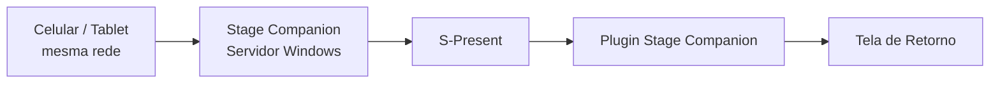

# Stage Companion — Edição Local para S-Present

O **Stage Companion** integra recepção/portaria, o **S-Present** e a tela de Retorno usando a **rede local da igreja**.

Esta atualização prioriza a instalação que tende a atender a maioria das igrejas: **Plugin S-Present + Servidor Windows/EXE + PWA local + Tema de Retorno**.

> **Não é necessário** Termux, celular Samsung como servidor, domínio, IP público fixo ou abertura de portas para a Internet.

## Candidata atual

| Componente | Versão |
|---|---|
| Edição local | **R18.6-HF5I LOCAL** |
| Plugin | **0.3.90** |
| Servidor Windows / PWA local | **0.8G-R18.6-HF5C** |
| Tema de Retorno | **R18.6-HF1** |
| Plugin ID | `com.stagecompanion.dev` |

**HF5I ainda está em validação de campo.** Por isso esta atualização está em uma branch/PR candidata e não deve ser tratada como release estável até concluir os testes no S-Present real.

## Arquitetura local



A PWA é servida pelo próprio PC Windows. O celular acessa o endereço local informado pelo Stage Companion.

## Recursos atuais

- Visitantes com inclusão, edição e exclusão rápida.
- Oportunidade de Louvor com **Cantor + Hino + Artista opcional**.
- Grupo por cantor na Setlist.
- Harpa Cristã em grupo único.
- Alertas, veículo e mensagens.
- Preparação/apresentação de **SEJA BEM-VINDO**.
- Integração com a tela de Retorno.
- Reconexão e reaplicação de estado.
- Proteções contra grupos/hinos duplicados.
- PWA local para voluntários.

## O que fica fora desta edição

A arquitetura completa via Internet — **Termux/Samsung, domínio, IP público, ponte externa e PWA pública** — continua sendo uma evolução separada do projeto e **não é requisito para a edição local publicada neste repositório**.

## Código da candidata

Enquanto a HF5I está sendo validada, o snapshot completo da candidata fica em:

```text
.local-src/source.b64.part00 ... source.b64.part09
```

O workflow **Build Stage Companion Local Candidate** reconstrói automaticamente esse snapshot, valida o plugin, compila o EXE Windows e gera os ZIPs da edição local. Isso evita substituir a versão estável da árvore principal antes da validação de campo.

Depois de aprovada em campo, a candidata será promovida para a árvore normal do repositório.

## Validação HF5I

Os pontos principais do teste atual são:

- `PREPARAR "SEJA BEM-VINDO"` → deve resultar em **1 grupo + 1 banner**, sem projetar.
- Repetir PREPARAR → não pode duplicar grupo nem banner.
- `APRESENTAR "SEJA BEM-VINDO"` → projeta o banner sem criar outra cópia.
- Primeiro hino da Oportunidade → deve receber confirmação sem cadastrar um segundo hino.
- Leituras atrasadas da Setlist → não podem provocar reenvio/duplicação.
- Visitantes, Harpa e Retorno não podem regredir.

## Instalação

Veja **[INSTALL.md](INSTALL.md)**.

## Segurança

Use a edição local em rede confiável. Nunca publique chave da API, token ou configuração real da igreja no GitHub.

## Licença

A licença pública definitiva ainda deve ser definida pelo mantenedor antes de redistribuição externa ampla.
